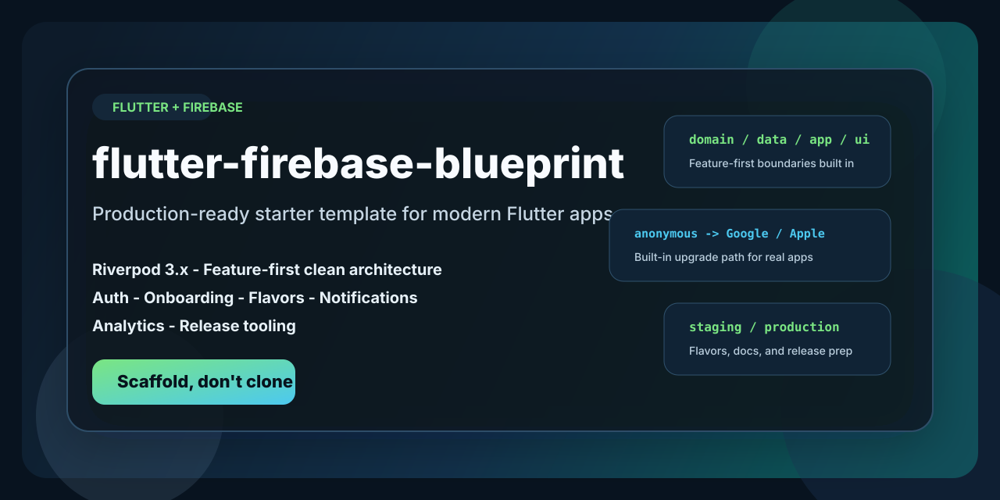
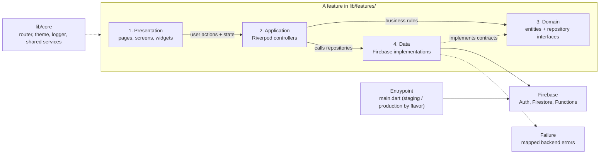

# flutter-boilerplate-blueprint

[](https://github.com/loipv/flutter-boilerplate-blueprint/tags)
[](https://github.com/loipv/flutter-boilerplate-blueprint/commits/main)
[](https://github.com/loipv/flutter-boilerplate-blueprint/blob/main/LICENSE)
[](https://github.com/loipv/flutter-boilerplate-blueprint)
[](https://github.com/loipv/flutter-boilerplate-blueprint)
[](https://github.com/loipv/flutter-boilerplate-blueprint)



Production-ready Flutter + Firebase starter template for teams that want a modern base: Riverpod 3.x, feature-first clean architecture, onboarding, anonymous-to-OAuth auth upgrades, staging/production flavors, optional notifications, analytics, and release tooling.

This repo is designed for teams who want to scaffold a real app foundation quickly, not clone a demo project and spend the next week removing outdated patterns.

## 1. Why this template is different

- Built for **Flutter + Firebase apps**, not a generic starter with Firebase added later
- Uses **feature-first clean architecture** instead of layer-first `controllers/models/views`
- Ships with **Riverpod 3.x code generation** throughout the stack
- Includes **anonymous auth to Google/Apple upgrade paths**, onboarding, and router guards
- Handles **staging/production flavors**, setup docs, release prep, and optional Functions scaffolding
- Keeps **Firebase, PostHog, and Sentry isolated** to the correct layers
- Generates a project with **AI assistant bootloader files** and project rules already in place

## 2. Who this is for

- Teams starting a new Flutter + Firebase app and wanting sensible defaults
- Solo builders who want structure without adopting an entire app framework
- Projects that need auth, onboarding, release prep, and environment separation on day one

## 3. Who this is not for

- Teams looking for a visual app kit or prebuilt product UI
- Projects that do not use Firebase
- Developers who want an unopinionated empty Flutter shell

## 4. Quick start

Latest stable blueprint version: `v1.3.0`

Review the script before running it. This scaffold requires `bash`; do not run it with `sh`. The `bash -c "$(curl ...)"` form downloads the whole script first, so nothing executes until the download finishes.

```bash
bash -c "$(curl -fsSL https://raw.githubusercontent.com/loipv/flutter-boilerplate-blueprint/main/scaffold.sh)"
```

If you need to reproduce an older blueprint version exactly, pin a tag. `BLUEPRINT_REF` selects the ref that gets cloned, so set it to the same tag as the script URL:

```bash
BLUEPRINT_REF=v1.3.0 bash -c "$(curl -fsSL https://raw.githubusercontent.com/loipv/flutter-boilerplate-blueprint/v1.3.0/scaffold.sh)"
```

The script prints the ref it uses. `BLUEPRINT_REF` also works with a local clone (`BLUEPRINT_REF=v1.3.0 bash scaffold.sh my_app`), picking a tag or branch from that clone instead of its `HEAD`.

The `v0.x` one-liners (tags `v0.6.0` to `v0.9.0`) no longer work: their script always clones `main` and reads a `template/` directory that `main` no longer has. This script cannot scaffold those tags either, since they have no `tool/init.dart`. To reproduce a `v0.x` version, clone that tag and run its own script:

```bash
git clone --depth 1 --branch v0.9.0 https://github.com/loipv/flutter-boilerplate-blueprint.git blueprint-v0.9.0
bash blueprint-v0.9.0/scaffold.sh
```

If you want to inspect the repo first, or skip the script, use "Use this template" on GitHub or clone it, then run the init tool:

```bash
git clone https://github.com/loipv/flutter-boilerplate-blueprint my_app
cd my_app
rm -rf .git  # start your own history; init runs git init
dart tool/init.dart
```

You can also pass a target directory and init flags to the script: `bash scaffold.sh my_app --yes --org io.acme`.

If you accidentally run the script with `sh`, it exits immediately with a message telling you to re-run it with `bash`.

The script clones the blueprint into the target directory, and `tool/init.dart` renames that clone in place into your app: package name, application id, display name, and the optional features you turn off. Then `tool/` deletes itself.
Generated apps also include a `BLUEPRINT_VERSION.md` file so you can see which blueprint version they were scaffolded from later.

## 5. Why this exists

Most starter projects help you get to the first screen. They do not help much with the parts that usually get messy later: auth upgrades, feature boundaries, router guards, preferences, release setup, and keeping Firebase details out of the wrong layers.

This template gives you the common plumbing without locking you into app-specific product decisions.

## 6. What you get

- Feature-first clean architecture with `domain`, `data`, `application`, and `presentation` layers per feature
- Riverpod 3.x with code generation throughout
- Anonymous sign-in on first launch, with upgrade paths to Google or Apple
- Onboarding flow with theme selection and optional account creation
- GoRouter setup with auth and onboarding guards
- Shared design system with bundled fonts, spacing tokens, and app theme
- App-level logging, haptics abstraction, and analytics abstraction
- Staging and production flavors
- Scaffolded iOS and Android flavor files for Firebase config, signing, and auth setup
- Optional local notifications with timezone re-sync and a basic reminder setting
- Optional Firebase Cloud Functions scaffold
- Makefile commands for run, build, test, codegen, and deploy workflows
- Project docs for setup, testing, release prep, and next steps
- `AGENTS.md` plus a `CLAUDE.md` bootloader for code assistants

## 7. Why teams pick this over older starters

Many Flutter + Firebase starter repos are still easy to find, but a lot of them were built around older state management, older Flutter/Firebase setup, or a "clone and manually rename everything" workflow.

This blueprint is intentionally optimized for:

- **Current architecture choices**: Riverpod 3.x, code generation, feature-first boundaries
- **Real app setup**: flavors, env files, auth setup docs, signing notes, release guidance
- **Migration-resistant structure**: Firebase stays in the data layer and entrypoints
- **Repeatable scaffolding**: `tool/init.dart` renames a clone in place instead of asking users to mutate a sample app by hand
- **Versioned blueprint releases**: `main` tracks the latest stable blueprint and tags preserve exact historical snapshots

## 8. Comparison snapshot

| Repo type                | Typical gap                                                                | This blueprint does instead                                                           |
| ------------------------ | -------------------------------------------------------------------------- | ------------------------------------------------------------------------------------- |
| Old Firebase starter     | Older packages, stale docs, manual rename flow                             | Versioned scaffold flow with current architecture rules                               |
| Generic Flutter template | Good app shell, weak Firebase/auth/release setup                           | Firebase-first setup, auth upgrades, docs, env split, flavor-aware structure          |
| Demo/reference app       | Useful patterns, but harder to repurpose as a clean starting point         | Generates a fresh project designed to be customized immediately                       |
| Low-opinion boilerplate  | Fast to clone, but leaves key architectural and setup decisions unresolved | Bakes in boundaries, docs, tooling, and feature defaults that most teams actually use |

## 9. What the scaffold asks

Each prompt has a flag. `--yes` accepts the default for anything you do not pass.

| Prompt                        | Flag                 | Default                           |
| ----------------------------- | -------------------- | --------------------------------- |
| Package name (snake_case)     | `--name`             | target directory name             |
| Organization (reverse domain) | `--org`              | `com.example`                     |
| Display name                  | `--title`            | package name in Title Case        |
| Short description             | `--description`      | `A new Flutter app`               |
| Notifications                 | `--no-notifications` | on                                |
| PostHog analytics             | `--no-posthog`       | on                                |
| Sentry error monitoring       | `--no-sentry`        | on                                |
| Cloud Functions (TypeScript)  | `--no-functions`     | on                                |
| Apple Sign-In                 | `--no-apple`         | on                                |
| Google Sign-In                | `--no-google`        | on                                |
| Anonymous sign-in             | `--no-anon`          | on                                |
| Firebase Remote Config        | `--no-remote-config` | on                                |
| Google AdMob ads              | `--no-ads`           | on                                |
| One app id for both flavors   | `--shared-app-id`    | off (staging uses `<id>.staging`) |

`--shared-app-id` lets staging builds go to the same TestFlight / Play Console app as production; see "One store app for both flavors" in `docs/release_guide.md` for the trade-offs.

Invalid input re-prompts in interactive mode; with flags it exits non-zero with the reason, before any file is changed.

At least one sign-in method (Apple, Google or anonymous) must stay on, since the app cannot leave onboarding without one. Turning all three off with flags exits with an error; interactively, init keeps the last one.

Bottom nav tab count, brand colors, the AI tool file, and FVM are not asked. Edit them by hand after scaffolding; `docs/next_steps.md` in the generated app covers each one. The Flutter SDK is pinned to `3.41.4` in `.fvmrc`.

## 10. Architecture at a glance

The template uses a feature-first clean architecture. Each feature owns four layers, and each layer has a narrow job.

Shared concerns such as routing, theming, logging, and error types live in `lib/core`. Firebase stays in entrypoints and data implementations.



Read it left to right: UI in `presentation` talks to controllers in `application`, business rules live in `domain`, and Firebase work happens in `data`. `lib/core` supports all features, and backend errors are mapped to `Failure` before they reach higher layers.

## 11. Generated project shape

```text
<your-app>/
├── lib/
│   ├── app.dart
│   ├── main.dart
│   ├── core/
│   │   ├── config/
│   │   ├── constants/
│   │   ├── data/
│   │   ├── domain/
│   │   ├── errors/
│   │   ├── presentation/
│   │   ├── providers/
│   │   ├── router/
│   │   ├── services/
│   │   ├── theme/
│   │   └── utils/
│   └── features/
│       ├── auth/
│       ├── onboarding/
│       ├── home/
│       ├── settings/
│       └── user_profile/
├── test/
├── integration_test/           # app flow on a simulator/emulator + Firebase Emulator
├── firebase_tests/             # Firestore and Storage rules tests (vitest)
├── scripts/                    # test layout check, coverage gate, integration stubs
├── .github/workflows/
│   ├── ci.yml
│   └── integration.yml         # manual Android emulator run
├── docs/
│   ├── next_steps.md
│   ├── setup.md
│   ├── auth_setup.md
│   ├── tech.md
│   ├── ui_ux.md
│   ├── testing_guide.md
│   ├── release_guide.md
│   └── android_signing.md
├── ios/
│   ├── config/
│   │   ├── Staging/
│   │   └── Production/
│   └── Runner/...
├── android/
│   └── app/src/{staging,production}/
├── functions/                  # optional, only if selected
├── .env.staging
├── .env.production
├── Makefile
├── firestore.rules
├── BLUEPRINT_VERSION.md
├── AGENTS.md
└── CLAUDE.md
```

## 12. Included out of the box

- Auth flow: anonymous session on first launch, plus Google and Apple upgrade paths
- Router guards: splash during cold start, onboarding redirect, stable bottom navigation
- Preferences: theme and haptics support with local persistence and user-profile sync points
- Error handling: data layer maps backend failures to a shared `Failure` type
- Analytics and monitoring: abstracted analytics repository, with optional PostHog and Sentry integrations
- Environment split: one entrypoint that picks staging or production config from the build flavor, plus per-flavor env files
- Platform setup: flavor-aware iOS and Android config files, release signing hooks, privacy manifest, and auth-related plist handling
- Notifications: optional local reminder scaffold with permission requests, scheduling, and timezone-aware resync
- Cloud Functions: optional TypeScript scaffold when selected
- Analytics config: supports custom `POSTHOG_HOST` for region-specific or self-hosted setups

## 13. Evaluation checklist

If you are comparing starters, this repo is easiest to evaluate by checking four things:

1. Can it scaffold a new app quickly without manual repo surgery?
2. Does it keep Firebase concerns out of the wrong layers?
3. Does it already handle auth, onboarding, environments, and release prep?
4. Is there a clear blueprint version and changelog story?

## 14. After scaffolding

Start with `docs/next_steps.md` in the generated project. For most teams, the first pass looks like this:

1. Create Firebase staging and production projects.
2. Run `flutterfire configure` for each environment.
3. Fill in `.env.staging` and `.env.production`.
4. Run `make run-staging`.
5. Replace the app icon and onboarding copy.

For deeper setup details, use:

- `docs/setup.md` for Firebase, signing, and first-run setup
- `docs/auth_setup.md` for Google Sign-In, Apple Sign-In, and App Check
- `docs/testing_guide.md` for test patterns and mock usage
- `docs/release_guide.md` for iOS and Android release prep
- `docs/tech.md` for architecture and package conventions

## 15. Project rules

The full contract lives in `AGENTS.md`. The short version:

| Area         | Rule                                                                              |
| ------------ | --------------------------------------------------------------------------------- |
| Architecture | Feature-first only: `lib/features/<name>/{domain,data,application,presentation}/` |
| State        | Riverpod `@riverpod` code-gen only                                                |
| Widgets      | `ConsumerWidget` or `ConsumerStatefulWidget`, not plain `StatefulWidget`          |
| Imports      | Absolute `package:` imports only                                                  |
| Spacing      | `Gap(AppSpacing.pX)`, not `SizedBox` for layout spacing                           |
| Icons        | `lucide_icons_flutter` only                                                       |
| Fonts        | Bundled Inter and JetBrains Mono only                                             |
| Logging      | `AppLogger`, not `print()` or `debugPrint()`                                      |
| Colors       | `Color.withValues(alpha:)`, not `Color.withOpacity()`                             |
| Firebase SDK | Confined to data layers and entrypoints                                           |
| Errors       | Map backend exceptions to the `Failure` union at the data boundary                |

## 16. Contributing

PRs are welcome. Keep the template focused on patterns that most apps actually need. If a feature is too specific to a single product, it probably does not belong in the base template.

## 17. Working on the blueprint

This repo is a runnable app. Clone it and work on it directly:

```bash
make setup            # pub get, code generation, functions and firebase_tests/ deps
make analyze          # static analysis
make test             # unit tests, including tool/ tests
make check-test-layout # every test file mirrors a source file
make coverage          # tests + per-layer coverage gate
tool/verify_init.sh   # run the init tool on a copy and check the result
```

`lib/firebase_options_staging.dart` and `lib/firebase_options_production.dart` are committed stubs. Before running `flutterfire configure` here, run `git update-index --skip-worktree` on both files so your generated config is not committed.

`tool/verify_init.sh` copies the working tree, runs `tool/init.dart` non-interactively, checks the result, then runs `make setup analyze check-test-layout coverage` in the copy. It deletes its temporary copy on success (set `VERIFY_KEEP=1` to keep it) and keeps it on failure. Pass init flags to try a combination, for example `tool/verify_init.sh --yes --name acme_notes --org io.acme --no-sentry`. CI runs three combinations on every push (`.github/workflows/blueprint.yml`).

Generated apps keep two workflows: `.github/workflows/ci.yml` runs on every push and pull request, with a `test` job (analyze, test layout check, coverage gate) and a `firebase` job (`make test-firebase`), and `.github/workflows/integration.yml` is started by hand and runs `make test-integration` on an Android emulator (see `docs/testing_guide.md`).

Anything that only makes sense in the blueprint (this README, release notes) sits between `<!-- BEGIN_BLUEPRINT -->` and `<!-- END_BLUEPRINT -->` lines in Markdown, or is a blueprint-only file; init removes both.

## 18. Releasing blueprint updates

The generated app has its own app version in `pubspec.yaml`. The blueprint itself has a separate version, defined in [`BLUEPRINT_VERSION.md`](./BLUEPRINT_VERSION.md).

When you cut a new blueprint version:

1. Update [`BLUEPRINT_VERSION.md`](./BLUEPRINT_VERSION.md).
2. Update the "Latest stable blueprint version" line in [`README.md`](./README.md).
3. Add a new entry to [`CHANGELOG.md`](./CHANGELOG.md) describing what changed in that blueprint release.
4. Commit the blueprint changes.
5. Create an annotated tag for the new version.
6. Push the branch and the tag.

Example for `v1.3.0`:

```bash
git add BLUEPRINT_VERSION.md CHANGELOG.md README.md
git commit -m "Release blueprint v1.3.0"
git tag -a v1.3.0 -m "Blueprint 1.3.0"
git push origin main
git push origin v1.3.0
```

The default quick-start command should point at `main`, which stays aligned with the latest stable blueprint. Tags are for reproducible snapshots when someone needs an older exact version. Users can check [`CHANGELOG.md`](./CHANGELOG.md) to see what changed between blueprint versions.

## 19. License

MIT
